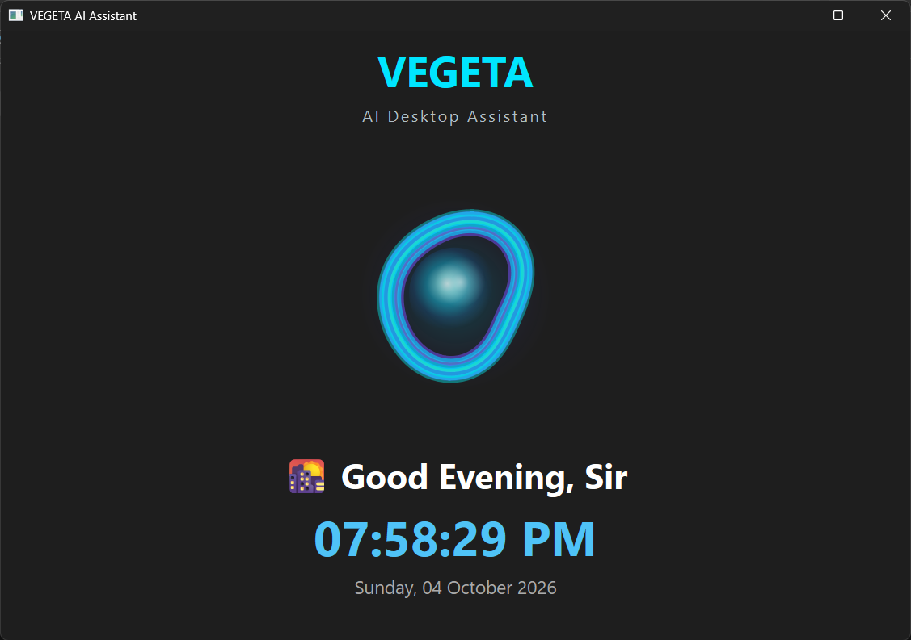

# VEGETA

### Voice-Enabled Generative Engine for Technical Assistance

> A voice-controlled AI desktop assistant for Windows that doesn't just talk to your computer — it interacts with it.



---

## About

VEGETA is a Python-based voice-controlled desktop assistant built for Windows.

The idea is simple: instead of manually opening applications, searching the web, navigating folders, switching windows, or repeating desktop tasks, you can speak to VEGETA and let it perform them.

For example:

> "Open Chrome."

> "Search YouTube for Python tutorials."

> "Open my Downloads folder."

> "Minimize Chrome."

> "Increase the volume."

> "Take a screenshot."

> "Remember that my project deadline is Friday."

VEGETA listens, processes the command, performs the required action, and responds through voice.

---

## What Can VEGETA Do?

### Voice
- Speech recognition and text-to-speech
- Global **Right Ctrl** push-to-talk
- Listening, thinking and speaking states
- Handles unclear speech safely

### Applications & Web
- Launch applications
- Open websites
- Search Google/web
- Search YouTube
- Maintain search context for follow-up commands

### Files & Desktop
- Open, create, find, list, rename, move and delete files/folders
- Clipboard control
- Keyboard and mouse automation
- Focus, minimize and maximize windows
- Windows UI inspection

### System
- Open Windows settings
- Control volume and mute/unmute
- Take screenshots
- Lock, restart and shutdown the computer

### Memory & Context
- Remember, recall and forget information
- Persistent local SQLite memory
- Recent conversation context
- Previous command/action/target tracking
- Search context

---

## Commands

VEGETA accepts natural variations instead of requiring one exact sentence.

### Applications

```text
Open Chrome
Launch Chrome
Open Notepad
Open Calculator
Open File Explorer
Websites & Search
Open Google
Open YouTube
Open GitHub

Search Python
Search Python tutorials
Search machine learning
Search TensorFlow tutorials
YouTube
Open YouTube
Search Python tutorials
Play Python videos
Exit search mode

If YouTube is opened first, VEGETA remembers it as the search target:

Open YouTube
→ Search Python tutorials
Files & Folders
Open Downloads
Open Documents
Open Desktop

Create a folder called Projects
Create a file called notes.txt

Find notes.txt
Rename this file
Move this file
Delete this file
List the files
Windows & Volume
Focus Chrome
Minimize Chrome
Maximize Chrome

Open Windows settings
Open display settings
Open sound settings
Open network settings

Increase the volume
Decrease the volume
Mute the volume
Unmute the volume
Memory & System
Remember that my project deadline is Friday
What do you remember?
Forget my project deadline

Take a screenshot
Lock the computer
Restart the computer
Shutdown the computer

Power-related commands are handled carefully because they can affect the current Windows session.

How to Use

VEGETA uses Right Ctrl as its global voice trigger:

Hold RIGHT CTRL
      ↓
Speak
      ↓
Release RIGHT CTRL
      ↓
VEGETA processes the command
      ↓
VEGETA performs the action
      ↓
VEGETA responds

The animated orb shows the current state:

IDLE → LISTENING → THINKING → SPEAKING → IDLE
Installation
Requirements
Windows 10/11
Python 3.12+
Git
Microphone
Speakers/headphones
Google Chrome
1. Get VEGETA

Using Git:

git clone https://github.com/ankeetworkspace27/VEGETA.git
cd VEGETA

Or download the repository as a ZIP from GitHub → Code → Download ZIP and open the extracted folder.

2. Create the environment
python -m venv .venv
.venv\Scripts\activate
3. Install dependencies
pip install -r requirements.txt
4. Run VEGETA
python main.py

Then hold Right Ctrl, speak, and release it.

To run without a console window:

.venv\Scripts\pythonw.exe main.py
Using VEGETA on Another PC

The GitHub repository contains the source code and project configuration. Each computer creates its own environment, installed applications, Windows configuration and memory database.

The complete setup is:

Clone / Download
      ↓
Install Python
      ↓
Create .venv
      ↓
Install requirements.txt
      ↓
Run main.py
      ↓
VEGETA is ready

The local memory database is:

database/vegeta.db

It is excluded from Git, so different users have separate memories.

Windows Startup

VEGETA can optionally start automatically with Windows.

Press:

Win + R

and enter:

shell:startup

Create a shortcut to:

<VEGETA_FOLDER>\.venv\Scripts\pythonw.exe

with:

Argument:
<VEGETA_FOLDER>\main.py

Start in:
<VEGETA_FOLDER>

For example:

Target:
D:\VEGETA\.venv\Scripts\pythonw.exe

Argument:
D:\VEGETA\main.py

Start in:
D:\VEGETA

Replace D:\VEGETA with your actual project location.

Technology Stack
Technology	Purpose
Python	Core application
PySide6	Desktop GUI and animated orb
SpeechRecognition	Speech recognition
sounddevice	Audio input
pyttsx3	Text-to-speech
pynput	Global keyboard listener
PyAutoGUI	Keyboard/mouse automation
pywinauto	Windows UI automation
psutil	System interaction
pycaw	Volume control
comtypes / ctypes	Windows API integration
Pillow	Image handling
SQLite	Persistent memory

Dependencies are defined in requirements.txt.

Architecture

VEGETA uses a modular architecture:

Voice / Right Ctrl
        ↓
Speech Recognition
        ↓
VEGETA Brain
        ↓
 ┌──────┼────────┬────────┐
 ↓      ↓        ↓        ↓
Apps  Search   Files   Windows
 ↓      ↓        ↓        ↓
        Memory / Context
                ↓
          Action Result
                ↓
          Text-to-Speech

Major modules:

ai/          Command processing
voice/       Listening and speaking
automation/  Files, windows, search, mouse, keyboard, clipboard
launcher/    Applications and websites
memory/      Persistent memory
database/    SQLite database
context/     Conversation context
ui/          PySide6 interface and orb
tests/       Component tests
Project Structure
VEGETA/
├── ai/
├── automation/
├── context/
├── database/
├── launcher/
├── memory/
├── ui/
├── voice/
├── tests/
├── assets/
├── main.py
├── config.py
├── requirements.txt
├── README.md
└── .gitignore
Safety & Privacy

VEGETA directly interacts with Windows, so safe execution is important.

The project includes:

Command cleaning and normalization
Error handling
Confirmation for important actions
Safe handling of unclear speech
Controlled system actions
Separate automation modules

Persistent memory is stored locally in:

database/vegeta.db

and is excluded from Git.

Testing

Core components have dedicated tests covering areas such as:

Clipboard
File management
File operations
Search
Windows
Context
Memory/database

Tests are located in:

tests/
Current Status

VEGETA currently has:

 PySide6 desktop interface
 Animated AI orb
 Voice recognition
 Text-to-speech
 Right Ctrl push-to-talk
 Application and website launching
 Web and YouTube search
 Search context
 File/folder management
 Clipboard control
 Window management
 Keyboard/mouse automation
 Windows UI inspection
 Windows settings
 Volume control
 Screenshots
 SQLite memory
 Conversation context
 System actions
 Windows startup
 Component testing
Limitations

VEGETA is an evolving project, not yet a commercial AI assistant.

Currently Windows-only
Command understanding is primarily rule/mapping based
Not yet a fully autonomous AI agent
Some browser features depend on Chrome
Automation can vary between applications and Windows environments
Some features may require an internet connection
Future Development

The long-term goal is to evolve VEGETA from a command-based assistant into a more intelligent desktop agent.

Planned directions include:

LLM integration for more flexible command understanding
Multi-step task execution
Screen understanding
Smarter memory
Task planning
Advanced desktop automation

The long-term vision is:

Voice
  +
Natural Language Understanding
  +
Memory
  +
Screen Understanding
  +
Task Planning
  +
Desktop Automation
Philosophy

The computer should understand the user, instead of forcing the user to understand the computer.

VEGETA is intentionally modular so that every major capability can be developed, tested and expanded independently.

Why VEGETA?

VEGETA is inspired by the Dragon Ball character and also represents:

Voice-Enabled Generative Engine for Technical Assistance

The project explores what a personal, voice-controlled desktop assistant can look like when it is built specifically for Windows.

Author

Ankeet Saha
B.Tech — Artificial Intelligence & Data Science

Disclaimer

VEGETA is an experimental personal desktop automation project. It interacts directly with Windows and installed applications, so users should review the source code and understand its behavior before running it.

License

No license has currently been added to this repository.


This cuts the README down **massively** while retaining the important information from your uploaded version—especially the installation and another-PC setup, which were unnecessarily repeated in the original. :contentReference[oaicite:1]{index=1}

Also, I intentionally **did not add the GIF/video section**, as requested.